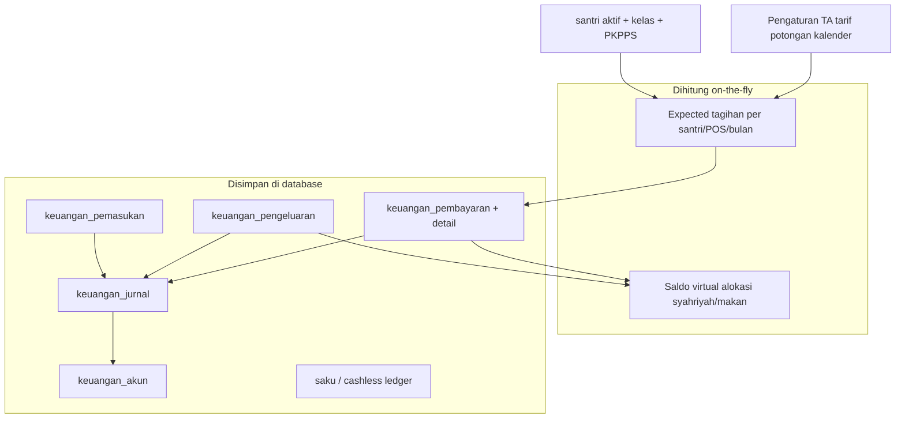
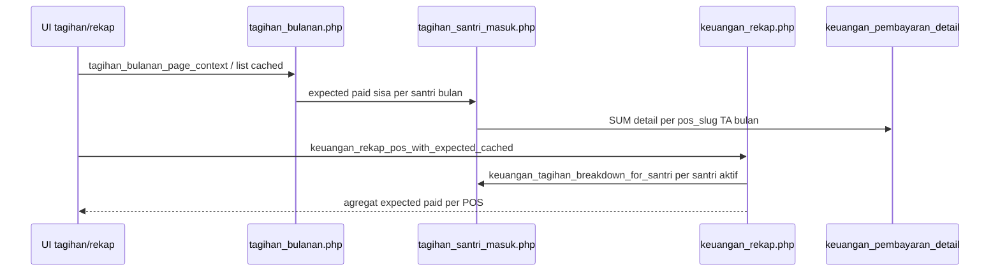
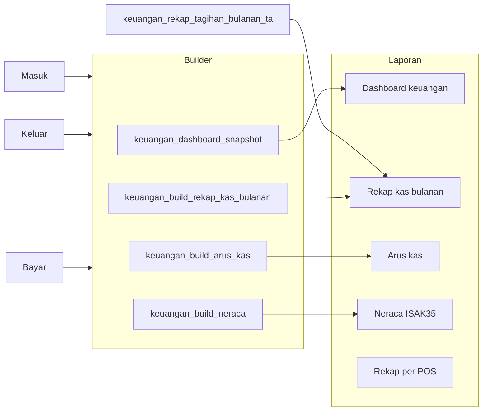
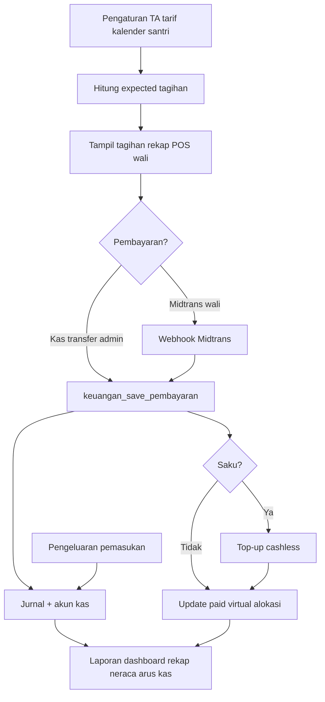
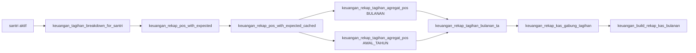

# Alur keuangan lengkap (kondisi saat ini)

Dokumen tunggal: arsitektur modul keuangan, pipeline tagihan/rekap, diagnostik, dan deploy aman — A.P.I Nailul Muna (developer/auditor/bendahara teknis).

---

## 0. Daftar isi

1. [Prinsip model data](#prinsip-model-data)
2. [Fondasi (sebelum ada transaksi)](#1-fondasi-sebelum-ada-transaksi)
3. [Alur tagihan (simulasi → tampilan)](#2-alur-tagihan-simulasi--tampilan)
4. [Alur pembayaran (masuk uang santri)](#3-alur-pembayaran-masuk-uang-santri)
5. [Alur pengeluaran, pemasukan, talangan](#4-alur-pengeluaran-pemasukan-talangan)
6. [Cashless & saku (titipan santri)](#5-cashless--saku-titipan-santri)
7. [Alokasi dana (virtual)](#6-alokasi-dana-virtual-bukan-transfer-bank)
8. [Akuntansi & laporan keuangan](#7-akuntansi--laporan-keuangan)
9. [Portal wali & Midtrans](#8-portal-wali--midtrans)
10. [Cache & konsistensi UI](#9-cache--konsistensi-ui)
11. [Peta modul (pintu masuk)](#10-peta-modul-pintu-masuk)
12. [Diagram end-to-end (satu TA)](#diagram-end-to-end-satu-ta)
13. [Pipeline tagihan & rekap (satu sumber logika)](#11-pipeline-tagihan--rekap-satu-sumber-logika)
14. [Rekap kas bulanan & rekonsiliasi UI](#12-rekap-kas-bulanan--rekonsiliasi-ui)
15. [Diagnostik CLI](#13-diagnostik-cli)
16. [Deploy aman & verifikasi produksi](#14-deploy-aman--verifikasi-produksi)
17. [Referensi cepat](#15-referensi-cepat)

---

## Prinsip model data



**Tagihan bulanan/awal tahun tidak disimpan sebagai invoice tetap** — `expected` dihitung dari pengaturan + profil santri; yang persisten adalah **pembayaran**, **pengeluaran**, **pemasukan**, dan **jurnal**.

---

## 1. Fondasi (sebelum ada transaksi)

| Lapisan | Isi | Helper / halaman |
|--------|-----|------------------|
| Tahun ajaran & bulan tagihan | TA aktif, slot 1–12 (Hijriyah/Masehi) | `helpers/pondok_kalender.php`, `settings/kalender.php`, `keuangan_periode_berjalan()` |
| Tier tarif | Syahriyah, makan, saku, komponen awal tahun | `keuangan/pengaturan.php`, `helpers/keuangan_defs.php` |
| Override | Tarif per bulan, kelas makan, opsional santri | `keuangan_tarif_bulanan`, `keuangan_kelas_makan` |
| Santri baru/lama | Bulan mulai wajib bayar, awal tahun baru vs lama | pengaturan wajib, `helpers/tagihan_santri_masuk.php` |
| Potongan & PKPPS | % potongan; tambahan PKPPS ke expected syahriyah | `helpers/keuangan_syahriyah_potongan.php`, `pkpps_santri` |
| Alokasi dana | Persen virtual syahriyah / awal tahun / makan | `helpers/keuangan_alokasi.php` |
| Akun kas/bank | 1101/1102 pondok, 1103 titipan, liabilitas saku | `helpers/keuangan_pengaturan.php`, seed di `keuangan_ensure_schema_deferred()` |

**Wajib lunas bulanan:** pos **syahriyah** (makan & saku opsional, tidak menentukan status wajib).

---

## 2. Alur tagihan (simulasi → tampilan)



**Halaman utama tagihan**

- Daftar bulan: `pembayaran/tagihan_syahriyah.php` — `tagihan_syahriyah_list_cached()`.
- Per santri 12 bulan: `pembayaran/rekap_tagihan_santri.php`, kartu syahriyah.
- Rekap POS + expected: `pembayaran/rekap_pos.php`.
- Portal wali: `wali/keuangan.php?tab=tagihan` — partial `wali/partials/keuangan_tab_tagihan.php`, helper `wali_portal_tagihan_*`.

**Jenis periode**

- `BULANAN` + `bulan_tagihan` 1–12 (match kalender Hijriyah/Masehi di SQL).
- `AWAL_TAHUN` — komponen awal TA terpisah; masuk total TA sekali (rekap kas: baris **Awal Tahun (TA)** + footer).

**Rumus ringkas:** `expected = tarif tier − potongan + PKPPS + override`; `paid` dari detail pembayaran; `sisa = max(0, expected − paid)` (rekap POS membatasi `paid` valid per POS: `min(paid, expected)`).

---

## 3. Alur pembayaran (masuk uang santri)

**Pintu masuk**

- Bendahara: `keuangan/pembayaran.php` → `keuangan_save_pembayaran()` di `helpers/keuangan_transaksi.php`.
- Portal wali: Midtrans Snap (`helpers/midtrans.php`) → webhook → pembayaran tercatat (metode `MIDTRANS`).
- Cek/koreksi: `pembayaran/cek_pembayaran.php`, admin `helpers/keuangan_pembayaran_admin.php` (update/hapus + audit + reverse jurnal/cashless).

**Langkah sistem (save)**

1. Validasi santri, TA, urutan bulan (tidak loncat), anti dobel, nominal ≤ sisa per pos.
2. Insert `keuangan_pembayaran` (header: tanggal, akun_id, jenis_periode, bulan_tagihan, metode).
3. Insert `keuangan_pembayaran_detail` (pos_slug, nominal).
4. Pos **saku** → `keuangan_pembayaran_apply_cashless_saku()` (top-up saldo santri).
5. Jurnal otomatis `helpers/keuangan_jurnal.php`:
   - Pondok: Dr kas/bank (1101/1102), Cr pendapatan.
   - Saku: Dr 1103 Kas Titipan, Cr 2101 titipan saku (bukan kas operasional pondok).
6. Invalidasi cache: `keuangan_mutasi_cache_invalidate()` (rekap POS + dashboard + tagihan list).
7. Redirect kuitansi: `keuangan/kuitansi.php`.

---

## 4. Alur pengeluaran, pemasukan, talangan

| Jenis | Halaman | Efek |
|-------|---------|------|
| Pengeluaran operasional | `keuangan/pengeluaran.php` | Kurangi saldo `akun_id`; jurnal beban; optional `alokasi_nama` + `pos` → kurangi pagu virtual alokasi |
| Pemasukan (donasi/hibah) | `keuangan/pemasukan.php` | Tambah kas; kategori sumber (donasi vs lain) dipakai rekap kas |
| Talangan internal | `keuangan/talangan.php` | Pinjam/kembali antar pos internal |
| Gaji pembimbing | `keuangan/gaji_pembimbing.php` | Bisa terhubung baris `keuangan_pengeluaran` (hindari double count di rekonsiliasi) |
| Inventaris | `keuangan/inventaris.php` | Aset + penyusutan (neraca) |

Riwayat terpadu masuk/keluar: `keuangan/riwayat_pembayaran.php` (helper `helpers/keuangan_riwayat_pembayaran.php`).

---

## 5. Cashless & saku (titipan santri)

Alur terpisah dari kas pondok operasional:

- Bayar pos saku → top-up saldo cashless.
- Scan jajan → mutasi liabilitas saku.
- Setor harian kantin → Dr/Kr pos internal cashless.

Modul: `keuangan/saku.php`, scan/setor/laporan cashless. Audit: `keuangan/perbaikan-saku.php`.

Di **rekap kas bulanan**, saku ditampilkan terpisah (`view=full`); **total masuk pondok** excludes saku (titipan).

---

## 6. Alokasi dana (virtual, bukan transfer bank)

- **Syahriyah:** persen komponen (PKPPS/gizi/KOPSA/…) dari dasar syahriyah; realisasi = pembayaran syahriyah TA; pengeluaran dengan `alokasi_nama` mengurangi saldo virtual komponen.
- **Makan:** pagu dari total bayar pos makan; pengeluaran dapur pilih alokasi grup makan.
- **Awal tahun:** alokasi terpisah untuk komponen awal TA.

Laporan: `pembayaran/laporan.php`, PKPPS, KOPSA, alokasi per santri.

---

## 7. Akuntansi & laporan keuangan



| Laporan | File | Sumber saldo/mutasi |
|---------|------|---------------------|
| Dashboard | `keuangan/index.php` | `keuangan_dashboard_snapshot_cached()` — neraca ringkas, tagihan bulan berjalan, kas/bank, rekap kas TA, WA tagihan |
| Rekap kas bulanan | `keuangan/rekap-kas-bulan.php` | Mutasi per slot bulan + tagihan TA + saldo fisik per akun |
| Arus kas | `keuangan/arus-kas.php` | Transaksi periodik + rekonsiliasi kas |
| Neraca | `keuangan/neraca.php` | Posisi keuangan per tanggal (scope pondok/saku/full) |
| Perbaikan selisih | `keuangan/perbaikan-kas.php` | Transaksi tanpa akun, analisis selisih buku vs fisik |

**Saldo kas operasional:** `keuangan_aruskas_total_kas($pdo, $asOf)` — opening + masuk per akun − pengeluaran per akun (akun aktif).

**Schema deferred:** banyak halaman memanggil `keuangan_ensure_schema_deferred($pdo)` (termasuk `includes/header.php`) — migrasi ringan `CREATE/ALTER IF NOT EXISTS` saat halaman dibuka, bukan impor SQL penuh.

---

## 8. Portal wali & Midtrans

- Tagihan & riwayat: `wali/keuangan.php` (tab tagihan / bayar / saku).
- Bayar online: Snap + `keuangan_midtrans_order`; webhook di host `pwa` (lihat [DEPLOY-LIVE.md](../DEPLOY-LIVE.md)).
- Notifikasi WA: `helpers/keuangan_wa.php` + cron `cron/wa_auto.php` — pengingat tagihan ke nomor wali.

---

## 9. Cache & konsistensi UI

Cache sesi (TTL ~600s, key TA/bulan/kalender):

- Dashboard snapshot, neraca, arus kas, list tagihan syahriyah, rekap POS expected/paid.

Invalidasi setelah mutasi: `keuangan_mutasi_cache_invalidate()` / `keuangan_dashboard_cache_invalidate()`.

Muat ulang paksa: `?refresh=1` di dashboard keuangan.

---

## 10. Peta modul (pintu masuk)

| Area | URL utama |
|------|-----------|
| Hub | `/keuangan/index.php` |
| Pengaturan | `/keuangan/pengaturan.php` |
| Input bayar | `/keuangan/pembayaran.php` |
| Tagihan | `/pembayaran/tagihan_syahriyah.php` |
| Rekap kas | `/keuangan/rekap-kas-bulan.php` |
| Panduan interaktif | `/keuangan/panduan.php` |

---

## Diagram end-to-end (satu TA)



---

## 11. Pipeline tagihan & rekap (satu sumber logika)

Satu rantai data — jangan duplikasi rumus tagihan di halaman rekap jika helper bersama sudah tersedia.



| Lapisan | Fungsi | File |
|---------|--------|------|
| Expected + paid valid per santri/POS | `keuangan_tagihan_breakdown_for_santri` | `helpers/tagihan_santri_masuk.php` |
| Agregat POS + expected | `keuangan_rekap_pos_with_expected` | `helpers/keuangan_rekap.php` |
| Cache sesi (TTL 600s) | `keuangan_rekap_pos_with_expected_cached` | `helpers/keuangan_rekap.php` |
| Agregat periode BULANAN / AWAL_TAHUN | `keuangan_rekap_tagihan_agregat_pos` | `helpers/keuangan_rekap_tagihan_bulan.php` |
| Baris bulan + total TA | `keuangan_rekap_tagihan_bulanan_ta` | `helpers/keuangan_rekap_tagihan_bulan.php` |
| Gabung ke baris kas + baris Awal Tahun | `keuangan_rekap_kas_gabung_tagihan`, `keuangan_rekap_kas_bulan_append_baris_awal_tahun` | `helpers/keuangan_rekap_kas_bulan.php` |
| Laporan POS (UI terpisah) | memanggil cached expected/paid | `pembayaran/rekap_pos.php` |

**Definisi**

- **expected:** kewajiban yang berlaku untuk santri dalam cakupan jenis periode + bulan tagihan + TA.
- **paid (rekap):** pembayaran valid, dibatasi `min(paid, expected)` per POS per santri (kelebihan → `paid_lebih`).
- **sisa (agregat):** `max(0, expected - paid)` per periode agregat; bukan selalu `sum(sisa per bulan)` jika ada kelebihan bayar lintas periode.

**Invalidasi cache**

Setelah mutasi pembayaran/pemasukan/pengeluaran: `keuangan_mutasi_cache_invalidate()` → unset rekap POS sesi + `keuangan_dashboard_cache_invalidate()`.

Pemanggil utama: `keuangan_save_pembayaran`, simpan pemasukan/pengeluaran, koreksi/hapus pembayaran admin, beberapa path tagihan santri.

---

## 12. Rekap kas bulanan & rekonsiliasi UI

**Penting:** Bagian ini menjelaskan desain dan perbaikan yang **dirancang di kode**; bukti masalah sudah selesai hanya ada setelah diagnostik + UI produksi. Gunakan [`BUKTI_VERIFIKASI_KEUANGAN.md`](BUKTI_VERIFIKASI_KEUANGAN.md) — jangan deploy hanya karena membaca dokumen ini.

### Akar masalah selisih footer vs baris (historis)

**Total tagihan** di footer/kartu (`tagihan['total']`) = jumlah tagihan **bulanan 1..N** + **Awal Tahun** (`keuangan_rekap_tagihan_bulanan_ta`).

Sebelum perbaikan, kolom **Terbayar/Sisa** per baris hanya dari baris bulanan (`keuangan_rekap_kas_gabung_tagihan`), sehingga jumlah manual baris bulan ≠ footer jika **Awal Tahun** punya `paid`/`sisa` signifikan (gejala produksi ~Rp66 juta selisih terbayar).

**Perbaikan UI (cakupan sama):**

- Baris tabel **Awal Tahun (TA)** — dana tagihan dari `tagihan['awal_tahun']`; kas AT kumulatif TA di kolom masuk/keluar awal tahun.
- Footer label: **Total TA (bulanan + awal tahun, …)**.
- Helper rekonsiliasi: `keuangan_rekap_kas_tagihan_subtotals()`.

**Logika saldo kas tidak diubah** — mutasi periode (`keuangan_rekap_kas_mutasi_periode`) + saldo fisik (`keuangan_aruskas_total_kas`). Jangan menyesuaikan saldo hanya agar cocok dengan total tagihan.

### File kode terkait (rekap/tagihan)

| File | Peran |
|------|--------|
| `helpers/keuangan_rekap_kas_bulan.php` | Builder rekap, render tabel, baris Awal Tahun |
| `helpers/keuangan_rekap_tagihan_bulan.php` | Agregat TA, subtotal, `keuangan_mutasi_cache_invalidate` |
| `helpers/keuangan_rekap.php` | Expected/paid per POS, cache |
| `helpers/keuangan_transaksi.php` | Simpan pembayaran + invalidasi cache |
| `helpers/keuangan_pembayaran_admin.php` | Koreksi/hapus + invalidasi |
| `keuangan/rekap-kas-bulan.php` | Halaman UI |
| `scripts/_diag_rekap_tagihan_reconcile.php` | Rekonsiliasi numerik CLI |

### Checklist pengujian (ringkas)

1. `php -l` pada file yang dirilis.
2. Diagnostik tagihan: selisih footer vs jumlah baris UI = **0** (termasuk baris Awal Tahun).
3. Diagnostik kas: aritmetika saldo TA konsisten; selisih fisik vs hitung terdokumentasi.
4. Simpan pembayaran → refresh rekap tanpa menunggu TTL cache.
5. Smoke: dashboard, `pembayaran/rekap_pos.php`, arus kas, neraca.

---

## 13. Diagnostik CLI

Jalankan dari root proyek (read-only terhadap data; hindari log PII berlebihan).

```bash
php scripts/_diag_rekap_tagihan_reconcile.php [tm] [ts] [bulan]
php scripts/_diag_rekap_kas_selisih.php
```

Windows XAMPP (PHP tidak di PATH):

```powershell
C:\xampp\php\php.exe scripts\_diag_rekap_tagihan_reconcile.php
C:\xampp\php\php.exe scripts\_diag_rekap_kas_selisih.php
```

**Output reconcile:** per bulan expected/paid/sisa, blok Awal Tahun, subtotal vs `tagihan.total`, selisih footer vs jumlah kolom Terbayar semua baris UI.

**Output selisih kas:** saldo awal/akhir TA, transaksi tanpa `akun_id`, gaji vs pengeluaran, selisih per bulan tagihan.

---

## 14. Deploy aman & verifikasi produksi

**Prinsip:** database **produksi** di hosting adalah sumber kebenaran — **jangan** impor ulang dump lokal / `impor_lengkap_*.sql` di live.

### Sebelum deploy

- [ ] Backup database produksi (phpMyAdmin / panel hosting).
- [ ] Backup file PHP produksi atau catat commit HEAD di server.
- [ ] Review `git diff`; commit hanya file relevan.
- [ ] `php -l` pada file yang diubah (versi PHP hosting ≈ lokal).

### Deploy kode

- **Manual / git pull:** [DEPLOY-LIVE.md](../DEPLOY-LIVE.md) — jangan timpa `config/database.local.php`, `uploads/`.
- **GitHub Actions:** workflow `.github/workflows/deploy-production.yml`
  - Trigger: `workflow_dispatch` (input `deploy`) atau tag `release-*`
  - Secrets: `SFTP_HOST`, `SFTP_PORT`, `SFTP_USER`, `SFTP_PRIVATE_KEY`, `SFTP_KNOWN_HOSTS`, `SFTP_REMOTE_ROOT`
  - Environment `production` + reviewer jika tersedia
  - Upload **allowlist** `DEPLOY_FILES` saja — bukan sync hapus seluruh server
  - Exclude: `.env`, config lokal, dump SQL, `uploads/`

### Setelah deploy (read-only)

- [ ] Rekap kas: footer Terbayar/Sisa = jumlah baris (bulanan + baris Awal Tahun).
- [ ] Kartu mini-stat = footer tabel.
- [ ] Saldo kas / neraca / arus kas — tidak regresi (tanpa transaksi uji di produksi kecuali prosedur disetujui).
- [ ] Log PHP & workflow sukses.
- [ ] Invalidasi cache sesi admin jika laporan masih stale (logout/login atau `?refresh=1`).

**Rollback:** restore file dari backup/commit sebelumnya — **bukan** restore database penuh jika sudah ada transaksi baru setelah backup.

---

## 15. Referensi cepat

| Kebutuhan | Lokasi |
|-----------|--------|
| Rumus tagihan/kas & peta tampilan (bendahara) | [PENJELASAN_KEUANGAN.md](PENJELASAN_KEUANGAN.md) |
| Operasional harian (setup, troubleshooting, FAQ) | [PANDUAN-KEUANGAN.md](PANDUAN-KEUANGAN.md) |
| Accordion ringkas in-app | `/keuangan/panduan.php` |
| Runbook hosting & cron WA | [DEPLOY-LIVE.md](../DEPLOY-LIVE.md) |
| Dokumen ini (arsitektur + pipeline + deploy) | **ALUR_KEUANGAN.md** (file ini) |
